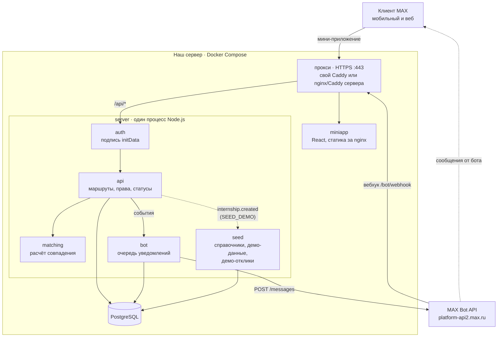
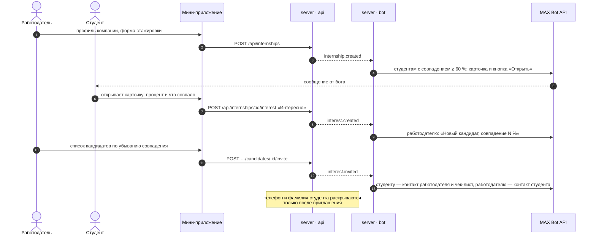
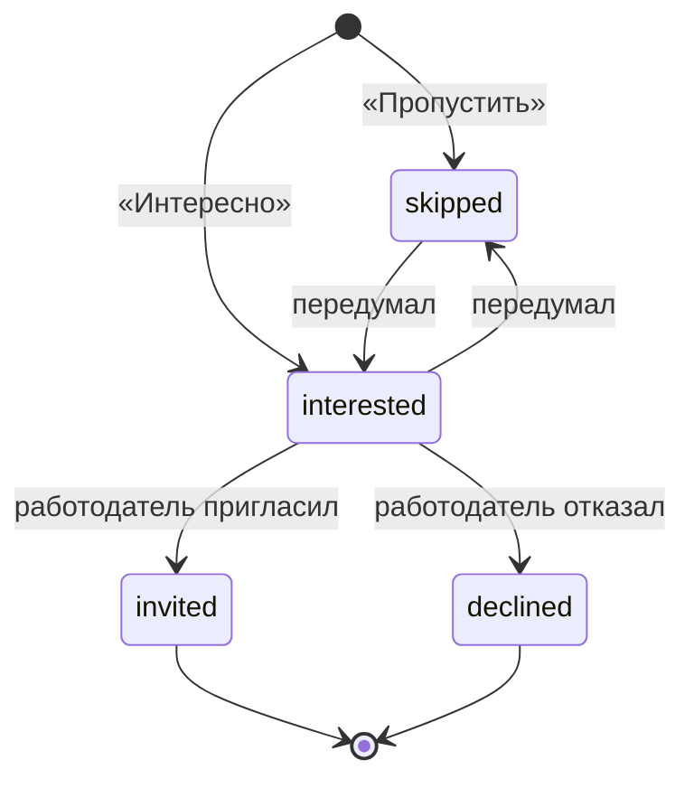
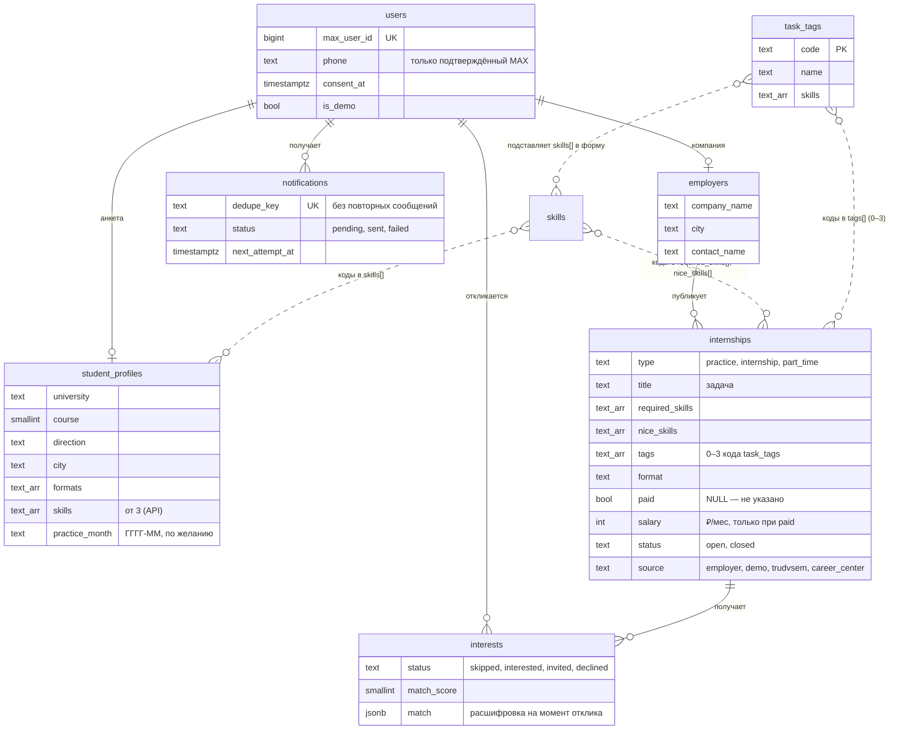

# Архитектура

Владелец — Андрей. Схемы для README и презентации. GitHub рисует их сам; для слайда — скриншот этой страницы
или экспорт через [mermaid.live](https://mermaid.live).

## Компоненты

| Компонент | Роль | Связи |
|---|---|---|
| Клиент MAX | открывает бота и мини-приложение, подписывает данные запуска | → Caddy по HTTPS |
| Прокси | TLS-сертификат, маршрутизация по пути: свой Caddy (`compose.prod.yaml`) или уже работающий на сервере nginx/Caddy (`compose.proxy.yaml`) | `/api/*`, `/bot/*` → server; остальное → miniapp |
| miniapp | экраны студента и работодателя; статика за nginx, контейнер `meb-miniapp` | → `/api` с заголовком `X-Max-Init-Data` |
| server · auth | проверяет подпись MAX на каждом запросе, находит пользователя | → db |
| server · api | профили, стажировки, лента, отклики, кандидаты; права и статусы | → matching, → db, публикует события |
| server · matching | чистые функции: фильтры и процент с расшифровкой | без БД и сети |
| server · bot | `/start`, уведомления по событиям, очередь с лимитами MAX | ← события, → db, → MAX Bot API |
| server · seed | при старте — справочники навыков и тегов задач (всегда) и тестовые данные (`SEED_DEMO=true`); в демо-режиме на новое место сразу откликаются до 5 подходящих тестовых студентов, без уведомлений | ← `internship.created`, → db |
| PostgreSQL | все данные | только внутри сети Docker |

**Почему так:** один процесс для API и бота — меньше движущихся частей; события внутри процесса — API не знает про
Bot API, бот не знает про HTTP; очередь уведомлений в той же БД — без отдельного брокера; расчёт совпадения — чистые
функции, которые покрыты тестами без БД.

## Основной сценарий

## Статусы отклика

Повтор того же действия ничего не меняет и не шлёт уведомление второй раз. Недопустимый переход — `409`.

## Данные

Схема — в миграциях `apps/server/src/db/migrations/`, они применяются при старте сервера.
